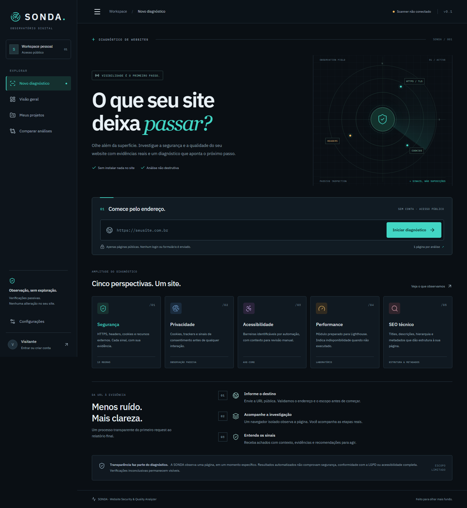

# SONDA · Website Security & Quality Analyzer

Um observatório digital para investigar websites com evidências reais. A SONDA recebe uma URL pública e produz verificações de segurança, privacidade e SEO. A versão publicada usa HTTP e HTML; o modo completo opcional acrescenta Chromium e acessibilidade automatizada. Não explora vulnerabilidades nem envia formulários.



## Estado do projeto

**A versão publicada funciona sem Docker:** [abrir SONDA](https://sonda-snowy.vercel.app). O modo HTTP consulta websites públicos com conexão segura, guarda relatórios em armazenamento privado Vercel Blob e mantém contas, projetos, histórico, comparação, SSE e exportações. Não exige instalar serviços na sua máquina. [Como funciona esse modo](docs/native-vercel.md).

Para executar localmente sem Docker: `pnpm install` e `pnpm dev:native`. O armazenamento local fica em `/storage/native` e os diagnósticos HTTP usam dados reais. A nota é provisória, com cobertura visível. Screenshot, recursos de navegador, axe-core e Lighthouse ficam explicitamente inconclusivos neste modo.

A implementação de scanner com navegador continua disponível separadamente em alvo aprovado. **Scans arbitrários com navegador ficam desabilitados por padrão.** Esse modo completo exige API/worker/runner com barreira de rede independente e PostgreSQL/Redis. Vercel não hospeda o navegador ou a fila. Configure API_URL para selecionar esse backend separado; sem API_URL e com Blob privado conectado, a Vercel usa o backend HTTP nativo.

13 regras SEC, API Fastify, Prisma/PostgreSQL, BullMQ/Redis, eventos SSE persistidos, autenticação com sessões HttpOnly, projetos, histórico, comparações, links revogáveis, exportação JSON/PDF, screenshots e armazenamento local/S3 estão implementados. Axe-core e verificações iniciais de SEO e privacidade usam dados coletados. **Lighthouse não está integrado ao pipeline** e retorna `INCONCLUSIVE`, sem nota fictícia. O adaptador MDN é opcional e ainda não está ligado ao pipeline.

Resultados e limites reais: [relatório de implementação](docs/implementation-report.md).

## Modo completo opcional com Docker

Requisitos: Docker Engine com Compose v2, kernel Linux com nftables (Docker Desktop usa VM Linux). Copie `.env.example` para `.env` e substitua `POSTGRES_PASSWORD` e `RUNNER_TOKEN` por valores aleatórios; token com pelo menos 32 caracteres. Não use esses exemplos em produção.

```sh
docker compose up --build -d --wait
```

Abra `http://localhost:3000`. Envie **`http://172.30.20.4:8080/`**, o único alvo local aprovado. A navegação é real, os cookies da fixture são minimizados e as descobertas são calculadas. Não há seed de relatórios fictícios. A API está em `http://localhost:4000`, OpenAPI em `/docs` no ambiente de desenvolvimento. PostgreSQL e Redis não são publicados no host.

```sh
node scripts/check-network.mjs
docker compose logs -f worker runner
docker compose down
```

O runner instala uma política nativa nftables antes de abandonar o usuário root; Chromium e o serviço executam como `pwuser`, sem credenciais PostgreSQL/Redis. A rede do navegador é interna. O alvo de teste é controlado. [Segurança operacional](docs/security.md) descreve o perfil público separado e as verificações obrigatórias antes de ativá-lo.

## Desenvolvimento sem Docker

Node 22 LTS, pnpm 10.13.1:

```sh
pnpm install
pnpm dev:native
```

O modo nativo inicia o frontend e o backend HTTP com armazenamento local. Se executar somente `pnpm dev` sem `API_URL`, token Blob ou `NATIVE_STORAGE_DIR`, os recursos que exigem backend apresentam erro explícito. Para testar o scanner completo em uma página local controlada:

```sh
pnpm exec playwright install chromium
pnpm test
```

O teste de integração inicia e encerra sua própria fixture local. Somente esse alvo é permitido; nenhum serviço privado real é sondado.

Para executar API e worker fora do Compose, configure PostgreSQL, Redis, `RUNNER_TOKEN`, `RUNNER_URL`, `STORAGE_DIR`, `WEB_ORIGIN` e a mesma `FIXTURE_URL` na API e no runner. Execute migrações e cada processo em um terminal separado. Esse modo permanece restrito à fixture.

```sh
pnpm db:migrate
pnpm --filter @sonda/api start
pnpm --filter @sonda/worker start
pnpm --filter @sonda/runner start
```

Carregue as variáveis no ambiente do processo. Os scripts não carregam `.env` automaticamente fora do Docker; em Node/tsx use `--env-file` ou seu gerenciador de processos.

## Qualidade

```sh
pnpm lint
pnpm typecheck
pnpm test
pnpm build
pnpm test:e2e
pnpm audit --prod --audit-level=high
```

`tests/api.integration.test.ts` exige o Compose e `RUN_API_INTEGRATION=true`. O E2E completo exige `E2E_FULL_STACK=true` e `E2E_EXTERNAL_SERVER=true`. Sem essas variáveis, os testes dependentes de infraestrutura são explicitamente ignorados, não contados como aprovados. CI roda ambos os modos e testa a barreira de rede do container.

## Arquitetura

```text
apps/web       Next.js App Router · React · Tailwind · TanStack Query · RHF
apps/api       Fastify · Zod · sessões e autorização · exports · SSE
apps/worker    BullMQ · persistência · retenção · cancelamento
apps/runner    Chromium + axe-core · serviço sem credenciais de dados
apps/egress    proxy HTTP/CONNECT · resolução e conexão com IP validado
packages/contracts   tipos e schemas compartilhados
packages/db          Prisma + migração SQL PostgreSQL
packages/scanner     coleta independente do motor de regras
packages/storage     storage local e adapter S3
infra                Dockerfiles · nftables · perfil público opt-in
tests                fixtures controladas · testes unitários/integrados/E2E
```

Dados sensíveis de cookie, queries e autenticação não entram no contexto persistido. URLs são sanitizadas. Screenshots têm acesso controlado e retenção; nomes são UUIDs gerados pelo serviço. Relatórios anônimos têm capacidade secreta e expiram em 7 dias, os da conta em 90 dias. Uma UUID não autoriza leitura de um relatório.

## Documentação

- [Arquitetura](docs/architecture.md), [API](docs/api.md), [Deploy](docs/deployment.md)
- [Segurança](docs/security.md), [Threat model](docs/threat-model.md), [Privacidade](docs/privacy.md)
- [Pontuação](docs/scoring.md), [Regras](docs/rules/README.md), [Entrega e checklist](docs/implementation-report.md)

## Limitações e próximos passos

Escopo de uma página; não inclui login, interação, crawl ou exploração. A nota não comprova segurança. SEO não busca robots.txt/sitemap. Lighthouse e MDN no pipeline, armazenamento de detalhes por elemento, acesso de times, recuperação de senha, verificação de e-mail e métricas operacionais ampliadas são próximos passos. O perfil público precisa de revisão e testes da infraestrutura onde for executado. IPv6 egress é bloqueado deliberadamente neste primeiro perfil.

Licença [MIT](LICENSE).
